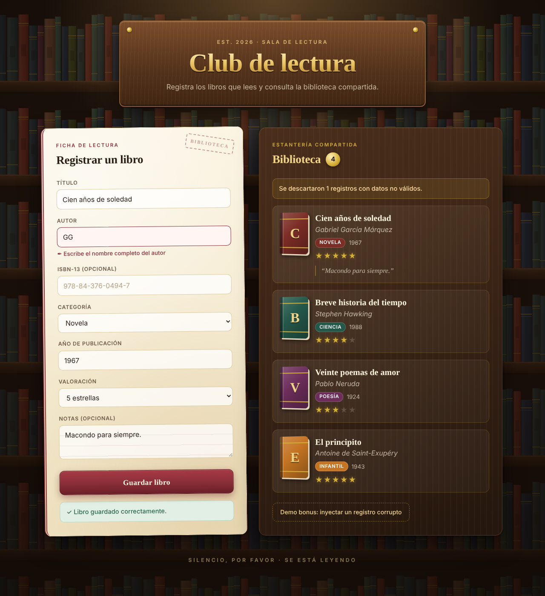

# Club de lectura · M4 Full Contact Forms



Aplicación React para registrar libros leídos en un club de lectura y consultar la biblioteca compartida.

- **Formulario:** React Hook Form (`register` + `handleSubmit`), con errores accesibles (`aria-invalid`, `aria-describedby`, `role="alert"`).
- **Validación:** un único esquema Zod (`src/schema.js`) conectado con `zodResolver`. Incluye un refinamiento propio para el dígito de control del ISBN-13.
- **Datos remotos:** TanStack Query v5 con `useQuery` para la lista y `useMutation` para guardar. Tras guardar se invalida la clave `['books']`.
- **Reto bonus:** cada registro que llega del "servidor" se valida con `safeParse`. Los registros corruptos se descartan y la interfaz avisa de cuántos han sido.

## Cómo arrancarlo

```bash
npm install
npm run dev      # servidor de desarrollo en http://localhost:5173
npm run build    # build de producción en dist/
```

El "backend" es una simulación en `src/api.js` que guarda en `localStorage`. Tiene latencia artificial y un 10 % de fallos al crear libros para poder probar los estados de carga, error y éxito. Para probar el reto bonus, pulsa **«Demo bonus: inyectar un registro corrupto»** debajo de la lista: mete en el almacenamiento un registro con valoración 9, sin autor y con fecha inválida. Al recargar la lista, `safeParse` lo descarta y aparece el aviso «Se descartaron 1 registros con datos no válidos».

## Estructura

```
src/
  main.jsx                 punto de entrada, QueryClientProvider
  App.jsx                  layout de la página
  schema.js                esquema Zod (fuente única de validación)
  api.js                   capa de peticiones simulada
  queries.js               hooks de TanStack Query
  components/
    BookForm.jsx           formulario con React Hook Form
    BookList.jsx           lista con estados de carga, error y vacío
  styles.css
```

## Uso de IA

- **Herramienta:** Claude (Anthropic), a través de Claude Code / claude.ai.
- **Qué se hizo con IA:** todo. El proyecto completo lo generó la IA a partir del enunciado de la práctica, que se adjuntó en la conversación: estructura de archivos, esquema Zod, capa de API simulada, hooks de TanStack Query, componentes, estilos (incluido el rediseño con tema de biblioteca y el fondo SVG de estanterías), este README y los commits.
- **Prompts reales usados:** «Haz la misión 4 según el enunciado adjunto y déjala en la carpeta mision4 del repositorio.» y «Métele un fondo que sea como una biblioteca, y dale más diseño, quiero que sea muy visual todo.»
- **Cómo se verificó:** la IA comprobó el esquema Zod con datos válidos, inválidos y corruptos, compiló los archivos JSX con esbuild y revisó que cada requisito de la rúbrica estuviera cubierto. El diseño se comprobó con una captura renderizada en un navegador sin interfaz.
- **Qué se escribió a mano:** nada. No hay código escrito a mano.

## Autopsia

1. **Backend simulado con `localStorage` en lugar de un servidor real.** Descarté un `json-server` o una API propia porque añadían infraestructura que la práctica no pide y complicaban el despliegue en la entrega. La contrapartida es que los datos son locales a cada navegador y que la "frontera" con el servidor es solo una convención.

2. **Invalidar toda la familia `['books']` tras guardar, en lugar de actualizar la caché de forma optimista.** Elegí la invalidación porque es más simple y siempre muestra datos reales del servidor. La alternativa, `setQueryData` con actualización optimista, ofrece una respuesta más inmediata pero obliga a gestionar la reversión si la petición falla, y el fallo aleatorio del 10 % lo hace más propenso a errores.
